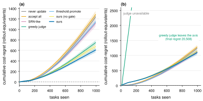
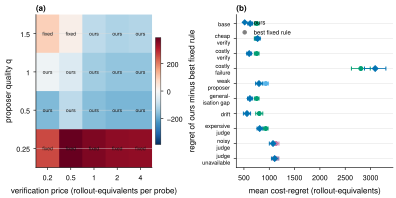
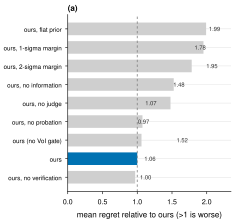
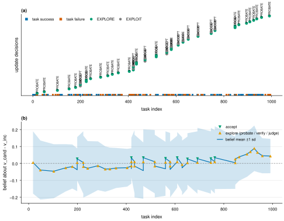

# Results: explore/exploit inside the learning-update rule

Status: the simulator stage is complete (phases P1, P2, P2b). The real-LLM replay stage
(P3-P4) has not started. Every number below comes from `results/grid.csv` (50 seeds per
cell, paired randomness) and is regenerated by `experiments/summarize.py`; the full tables
are in `results/tables.md` and the figures in `figs/`.

## 1. What was built

**The object of study.** An agent keeps one incumbent skill per task family. A proposer
offers candidate rewrites of that skill. For every candidate the agent must choose:
*skip it, accept it, put it on a live trial (probation), buy paid verification rollouts,
or ask a pairwise judge*. Being wrong is not free: every failed task costs `c_fail` extra
rollout-equivalents on top of the task, and every probe costs tokens. The question is
which action to take, given what the agent currently believes about the candidate.

**The controller ("ours").**

1. *Belief.* A grid posterior over $D = v_{\text{cand}} - v_{\text{inc}}$, the candidate's
   advantage over the incumbent. The prior is the population mixture of rewrite deltas
   calibrated to EvoGuard's reported rewrite statistics (42.2% worse, 7.7% tie, 50% better,
   exponential tails with the 10-point tail masses matched). The evidence is the candidate's
   own live outcomes (Bernoulli on $v_{\text{cand}}$), its paid verification rollouts
   (Bernoulli on $v_{\text{cand}} + \text{shift}$), and pairwise judge verdicts (correct with
   probability 0.7). No conjugacy is assumed anywhere.
2. *Action values*, in cost units, against "keep the incumbent":
   $\text{ACCEPT} = c_{\text{fail}}\, H\, \mu$;
   probation with $n$ live observations $= c_{\text{fail}} H_n\, \mathbb{E}[D \cdot 1\{\text{accept}\}]
   + n\, c_{\text{fail}} \mu - (\text{opportunities lost}) \times (\text{value of an opportunity})$;
   verification with $k$ probes $= c_{\text{fail}} H\, \mathbb{E}[D \cdot 1\{\text{accept}\}] - k\, p_{\text{verify}}$;
   judge $= c_{\text{fail}} H\, \mathbb{E}[D \cdot 1\{\text{accept}\}] - p_{\text{judge}}$.
   $H$ is the family's remaining tasks; $H_n = H - n/q_p$, because a live trial takes the
   incumbent's traffic while it runs.
3. *The information term is exact.* For a plan that buys $n$ observations, every possible
   outcome (a binomial count) is enumerated; the posterior is recomputed on the grid, the
   acceptance rule is applied, and the realised gain $D$ is counted only if the candidate
   would be accepted. No Gaussian approximation is used to value information.
4. *A live trial is dearer than it looks.* A trial occupies the family's single candidate
   slot, so every task it consumes is an update opportunity in which no new candidate could
   be requested. That opportunity cost was found by the model (not by tuning) and it is what
   makes the controller prefer an instantaneous, cheap judgement over a slow live trial
   whenever a good judgement is available.
5. *A gate on proposing.* A candidate is requested only when the best action on it is worth
   more than the proposal itself.

**Baselines** are the fixed rules the literature actually uses: never update, accept every
candidate, the SRN-style bounded note from *The RSI Tax*, EvoGuard's greedy pairwise judge,
StepLearn's threshold promotion, FGSE's probe gate with a lower confidence bound, and
always-verify. Their rules and parameters are copied, their systems are not reproduced, so
they are labelled "-style" throughout.

**Metric.** Cost-regret against the cheaper of never-updating and a free-information oracle
on the same seed, so "do nothing" and "know everything" both score 0. All policies see the
same pre-drawn randomness per seed, so every comparison is paired.

## 2. Headline

In the base regime (6 families x 1000 tasks, 50 seeds) the controller's cost-regret is
**623 +/- 47** against **752 +/- 46** for the strongest fixed rule, EvoGuard's greedy judge:
a paired difference of **-129 [-166, -91]**, with the controller better on 86% of seeds.

| policy | cost-regret (base) | total cost | failures | proposals | verification | judge calls | final success | harmful commits |
|---|---|---|---|---|---|---|---|---|
| never update | 1,248 | 3,571 | 514 | 0 | 0 | 0 | 0.486 | 0 |
| accept every candidate | 1,291 | 3,614 | 483 | 198 | 0 | 0 | 0.517 | 100 |
| SRN-like bounded note | 1,127 | 3,450 | 472 | 92 | 0 | 0 | 0.528 | 47 |
| threshold promote (StepLearn-style) | 1,151 | 3,474 | 490 | 22 | 0 | 0 | 0.510 | 3 |
| greedy pairwise judge (EvoGuard-style) | 752 | 3,075 | 371 | 198 | 0 | 20 | 0.629 | 34 |
| probe gate with LCB (FGSE-style) | 5,070 | 7,392 | 448 | 198 | 3,955 | 0 | 0.552 | 2 |
| always verify (AtomSearch-style cost) | 20,417 | 22,740 | 353 | 198 | 19,776 | 0 | 0.647 | 20 |
| **ours** | **623** | **2,946** | 358 | 115 | 21 | 21 | 0.642 | 20 |

The controller reaches the same skill quality as the greedy judge (0.642 vs 0.629 success)
while making 14 fewer harmful commits, spending 82 fewer proposals, and paying 13 fewer
failures. The two fixed-probe rules buy the *highest* skill quality of all (always-verify
reaches 0.647) and pay for it with 20,000 rollout-equivalents of verification - 8x the
controller's regret and 33x the greedy judge's. This is the RSI Tax result reproduced inside
a controlled stream: verification dominates update cost when it is bought unconditionally.

Across the ten named regimes the controller is significantly better than the greedy judge in
eight, tied in one (A), and worse in one (C) (paired differences, 95% intervals). The greedy
judge is not the strongest fixed rule in every regime, so the next paragraph repeats the
count against the best fixed rule *in each regime*; that is the fairer headline.

| regime | what changes | ours - greedy judge | ours | greedy judge |
|---|---|---|---|---|
| base | - | **-129 [-166, -91]** | 623 | 752 |
| A_cheap_verify | probes cost 0.2 | +18 [-38, +74] | 770 | 752 |
| B_costly_verify | probes cost 2.0 | **-148 [-183, -112]** | 604 | 752 |
| C_costly_fail | a failure costs 20 | **+283 [+56, +510]** | 3,092 | 2,808 |
| D_weak_proposer | proposer quality 0.5 | **-157 [-207, -106]** | 797 | 954 |
| E_gen_gap | held-out shift 0.08 | **-134 [-172, -96]** | 618 | 752 |
| F_drift | skill values random-walk | **-242 [-324, -160]** | 560 | 803 |
| G_dear_judge | a comparison costs 1.0 | **-118 [-160, -77]** | 811 | 930 |
| H_noisy_judge | judge accuracy 0.55 | **-132 [-185, -79]** | 1,075 | 1,207 |
| J_no_judge | a comparison costs 100 | **-19,401 [-19,476, -19,326]** | 1,107 | 20,508 |

**Against the best fixed rule in each regime** (corrected after verification; computed from
`results/grid.csv`, paired bootstrap 95% intervals): the controller is better in **6** regimes
(base, B, D, E, F, G), tied in **3** (A, H, J) and worse in **1** (C). The three regimes where
the best fixed rule is not the greedy judge: in D it is threshold promote (ours -134
[-218, -48]); in H and J it is the SRN-like note (ours -53 [-125, +19] and -20 [-84, +45], both
tied). So J's headline of -19,401 is not an advantage of ours: it measures how badly a fixed
"always ask the judge" rule fails when the judge is unaffordable, while a simple fixed rule
(SRN-like) is already as good as the controller. An earlier version of this report said
"seven better, one tied, one worse" (which does not sum to ten); the counts above replace it.

Figure 1 shows the regret curves. The controller's curve stays lowest from the first few
hundred tasks; the greedy judge's curve is indistinguishable in the base regime but diverges
completely when the cheap comparison becomes unaffordable, because it keeps paying for a
signal that no longer pays for itself.



## 3. When does a cost-aware rule pay?

The sweep in figure 4a varies the price of a verification probe against the quality of the
proposer (20 seeds per cell). The controller wins **13 of 20 cells**, with a median margin of
-102 cost units over the best fixed rule in that cell. The three columns of the map are not
symmetric:

- **Good proposer (q = 1.0), any probe price**: the controller wins, and by more as probes get
  expensive (at 2.0 per probe it is 154 units ahead). It buys the cheapest informative
  channel instead of the most obvious one.
- **Very good proposer (q = 1.5) with cheap probes (0.2, 0.5)**: the greedy judge wins (by 92 and
  24 units). When almost every candidate is good, accepting after one cheap look is hard to beat.
  At probe prices of 1.0 and above the controller wins again.
- **Medium proposer (q = 0.5)**: the fixed rules fail (threshold promote loses 968), the
  controller wins by 103-179. Here the deciding factor is *how much* to trust a rewrite.
- **Weak proposer (q = 0.25)**: the controller loses to **never updating** (965 vs 574). Its
  prior assumes a proposer of quality 1.0, so it keeps buying candidates that a calibrated
  agent would ignore. This is the clearest failure mode of the current rule, and it is a
  *learning* failure, not a decision failure: the fix is to estimate the proposer's quality
  online from the candidates already tried, which is exactly the update rule learning its own
  environment.



## 4. What each part of the rule contributes

Figure 6 averages the regret over all ten regimes; the numbers below are the base regime.

| variant | base regret | what it shows |
|---|---|---|
| ours (full) | 623 | - |
| ours without the propose gate | 694 | the gate is worth 71 units: asking the proposer when the answer is worthless is a pure cost |
| ours without the verification channel | 671 | paid probes add 48 units in the base regime, where a cheap judgement is already available |
| ours without the probation channel | 700 | live trials add 77 units |
| ours without the judge channel | 1,186 | **the cheap pairwise judgement is the most valuable channel by far** |
| ours without any information channel | 1,177 | buying information is worth 554 units; without it the rule collapses onto a fixed rule |
| ours with a 1-sigma acceptance margin | 1,515 | **risk aversion destroys the rule here** |
| ours with a 2-sigma acceptance margin | 1,315 | ditto |
| ours with a flattened prior | 1,711 | the population prior carries most of the weight |



Two of these deserve emphasis because they are counter-intuitive:

**A conservative acceptance rule is worse than a risk-neutral one.** The rewrite effect sizes
in this stream are small (a typical rewrite moves success probability by about 0.06), while the
spread of the controller's belief about a candidate's advantage is larger than any posterior
mean it reaches. Measured on the seed-3 trace of the full controller (280 decisions): the
posterior mean advantage has median 0.009 and 99th percentile 0.034, the candidate-only
posterior sd has median 0.08, and the sd the margin is applied to (which also includes
uncertainty about the incumbent's own value, median 0.15) has median 0.16. A one-sigma margin
therefore rejects almost everything: the controller accepts 0 candidates and behaves like
"never update". (An earlier draft said the prior's uncertainty is "about 0.09"; the margin is
actually applied to the wider sd above, and the conclusion holds a fortiori.) This is a real
warning for the design of any calibrated admission gate - the margin must be smaller than the
effect it is meant to protect against, and in this population there is no room for one.

**The regime that defeats the controller is not a decision failure but a prior failure.**
With a weak proposer, the right action is to stop updating entirely, and the controller
cannot know that because its prior about the population of rewrites is fixed at
EvoGuard's calibration. A controller that updated its prior online would close this gap.

## 5. The decisions are inspectable

Every run writes one append-only log (`results/viewer/<policy>.trace.jsonl`). Nothing in the
viewers is computed separately from the log, so what an advisor sees is what the system did.
A decision record looks like this (candidate `f5-c9`, base regime, seed 3):

```json
{"type": "ACTION_CHOSEN", "t": 304, "family": 5, "candidate_id": "f5-c9",
 "action": "JUDGE", "mode": "EXPLORE", "greedy_action": "SKIP",
 "rule_id": "c3_voi_propose.expected_net_value",
 "rule_inputs": {"mu_D": -0.0161, "s_D": 0.2642, "p_better": 0.3101,
                 "inc_mean": 0.5, "inc_sd": 0.25, "horizon": 113.9,
                 "best_probe_n": 3, "best_verify_k": 10},
 "scores": {"SKIP": 0.0, "ACCEPT": -9.19, "JUDGE": 2.25, "PROBATE": -23.60, "VERIFY": -2.63},
 "reason": "f5-c9: belief D=-0.016+/-0.264 (P(better)=0.31), 114 tasks left. Net value:
            SKIP +0.0, ACCEPT -9.2, JUDGE +2.3, PROBATE -23.6, VERIFY -2.6 -> JUDGE
            (explore: buys information)"}
```

Reading it: the candidate looks slightly worse than the incumbent but the belief is wide
(sd 0.26), so the controller does not know enough to discard it. Paying 0.1 for a pairwise
comparison is worth 2.3 units; buying 3 live trial observations is not worth it (-23.6, mostly
because the trial would block three further update opportunities), and 10 verification
rollouts are not worth it either (-2.6). The greedy action without buying information would
have been to skip the candidate.

The record states the belief, the value of every alternative including the one not taken,
the greedy action (what would have been chosen without buying information), and a sentence
explaining the choice. The truth layer is separate and can be revealed afterwards.



Two viewers read the same log:

- `results/viewer/viewer.html` - a single offline file (no server, no network). Policy
  picker, per-family task lanes, a belief panel, decision cards with the scores of the
  alternatives, a skill-lineage table, the cost ledger, an explore-only filter, a truth
  toggle, and a compare mode that puts two policies on the same seed side by side.
- `uv run python -m ee_update.tui results/viewer/c3_voi_propose.trace.jsonl` - a Textual
  terminal viewer with the same content: task strip, belief bar, scrolling decision log,
  ledger, and lineage. Keys: `space` play/pause, `n`/`b` step through decisions, `p` switch
  policy, `t` toggle truth, `e` explore-only, `/` search a skill, `q` quit.

## 6. What this does not show

- **No language model was involved.** These are decision-logic results on a simulated
  stream. The candidate quality distribution is calibrated to one paper's rewrite statistics
  (EvoGuard, ALFWorld, one generator); the cost model is in rollout-equivalents, not dollars.
- **One candidate per family at a time**, one scalar value per skill, candidates independent
  of each other. Real proposers learn from earlier feedback and real skills are
  context-dependent.
- **The judge is a binary sign with a fixed accuracy.** A real pairwise comparison is
  noisier, correlated across candidates, and biased toward verbose or familiar-looking
  rewrites.
- **The controller's prior is fixed.** It does not learn the proposer's quality, which is
  exactly where it loses (section 3).
- **The controller is risk-neutral.** It loses in the costly-failure regime, where being
  more conservative pays.
- **The two fixed-probe baselines are one instance of their family** (20 and 100 probes, one
  confidence level each). Their parameter choices are from the source papers, not tuned.

## 7. Next steps

1. **Learn the proposer online.** Maintain a posterior over the population of rewrite deltas
   and update it from the outcomes of the candidates already tried; then the "never update"
   corner of the regime map becomes reachable. This turns the rule from a fixed prior into
   something that actually learns, which is the point of the exercise.
2. **Scale risk with the stakes.** Replace the fixed margin with a criterion whose width grows
   with $c_{\text{fail}}$, or add a value-at-risk term, and re-run the costly-failure regime.
3. **Real-LLM replay (P3-P4).** Build the task suite and the replay table described in
   `docs/06_replay_table_spec.md` with open models on the user's NVIDIA key, replay every
   policy on the real outcomes, and show the same viewers on a real trace. The simulator
   tells us which decisions to look at; the replay tells us whether the decision logic
   survives real model behaviour.
4. **Held-out regimes.** The controller's hyperparameters (the acceptance margin, the prior
   weight, the probe sizes) were chosen on the development regimes `base`, `D`, `F`, `G`; the
   remaining regimes were not used for any choice.
